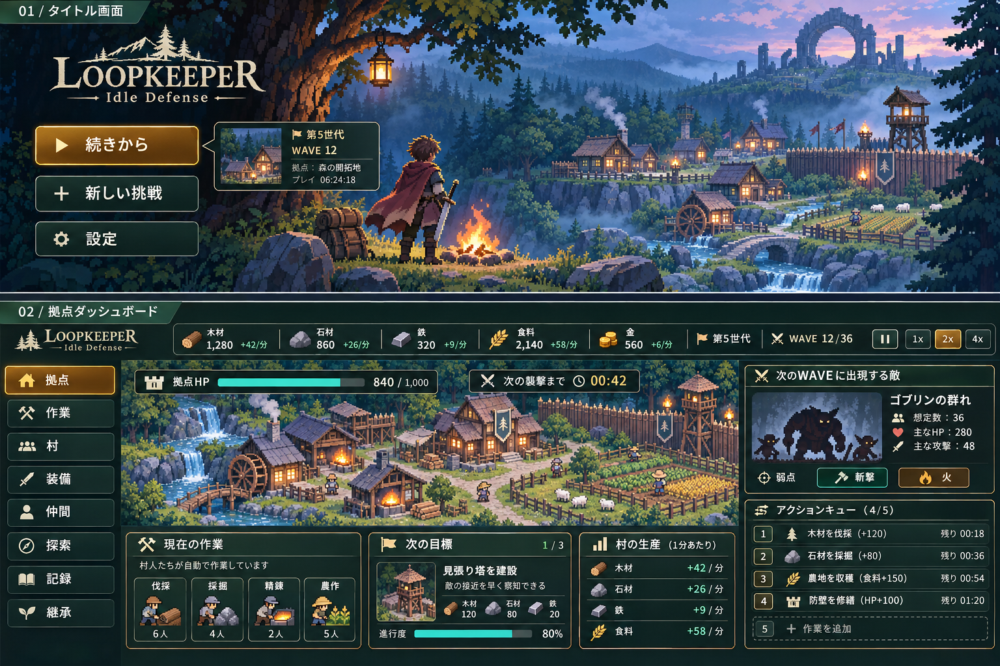
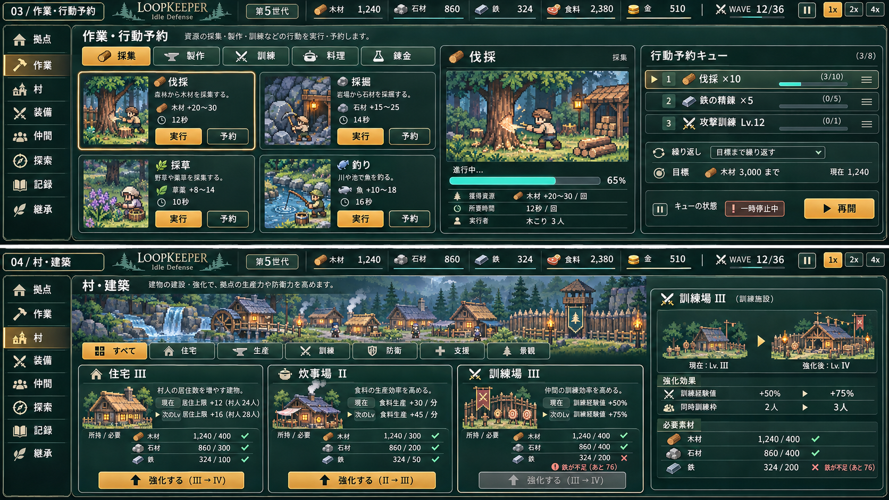
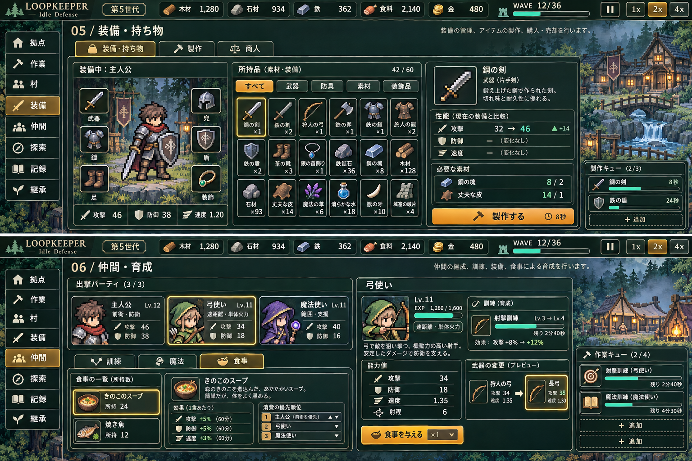
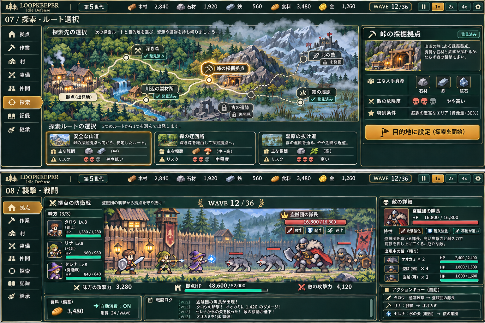
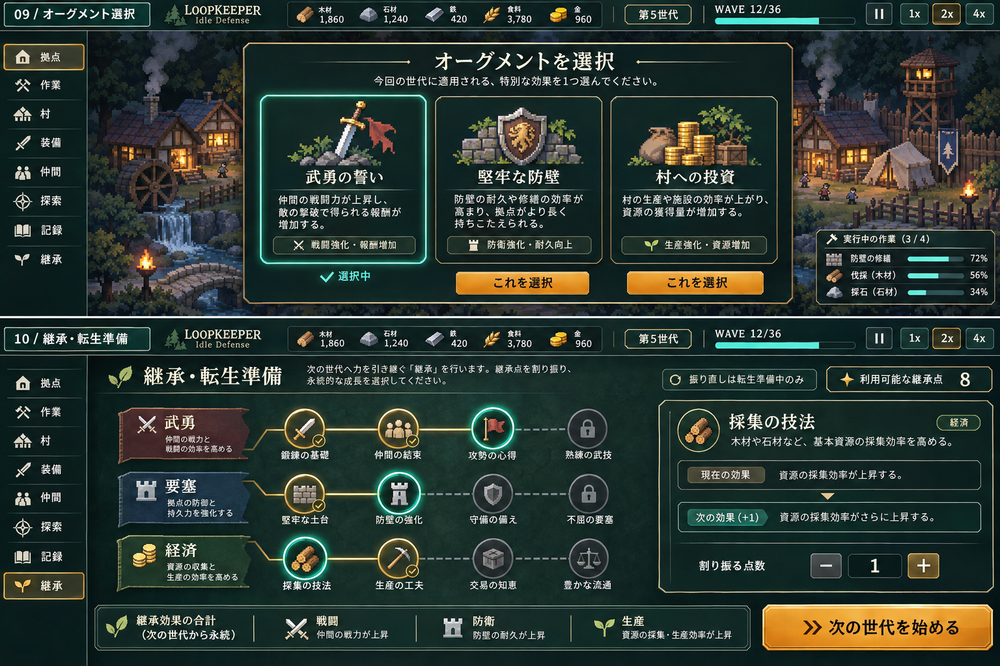
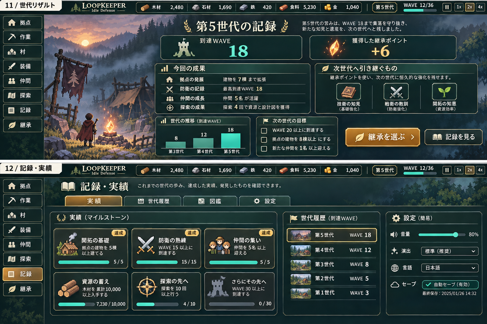
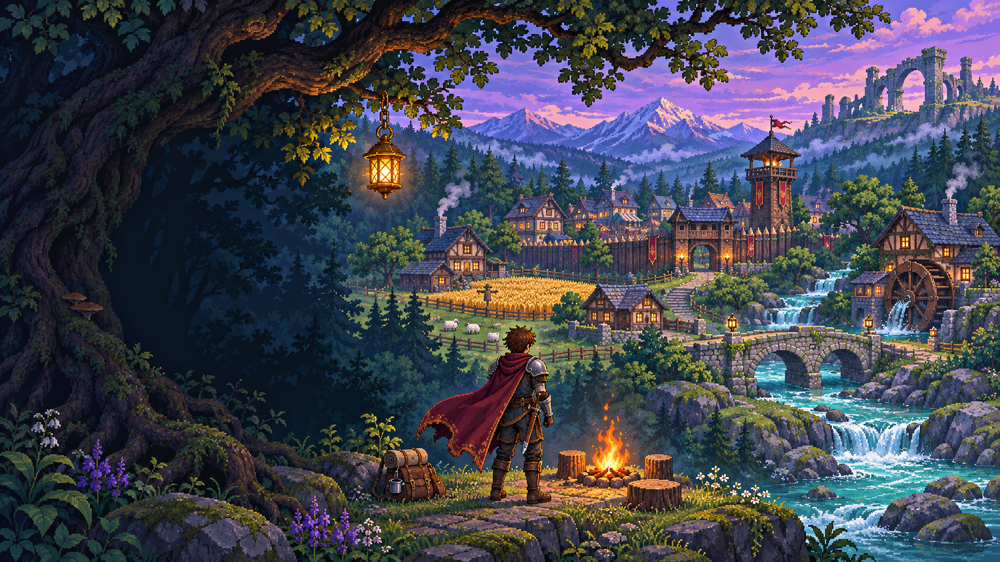

# LoopKeeper UI参考画像集

GPT・Claudeと開発者が共通で参照する、ユーザー提供のデザイン資料です。
2026-11-13提供の13ファイルをSHA-256で照合し、完全一致する6組をまとめて原本7枚を保存しました。画像の再圧縮・縮小・加工はしていません。

## 利用方針（両エージェント共通）

- UIやグラフィックの実装・レビュー時は、該当画面の画像を実際に開いて比較してください。
- 深緑のパネル、細い金枠、クリーム色のアイコン、ドット絵、文字と絵の配置を参考にします。
- **見た目の参考資料であり、実装済み画面や確定したゲーム仕様ではありません。** 画像内の人数・生産量・HP・倍率・装備枠・機能を、そのまま実装要件にしないでください。
- 仕様は最新のユーザー指示と作業環境の `docs/decisions.md`・`docs/design.md` を優先し、未実装案と実装済みを区別してください。設計文書は作業環境にのみ存在する場合があります。
- 背景と動く素材を分離する既存方針は継続。画像全体を動く動画として実装する指示ではありません。
- 原本はこのフォルダーに保持し、加工版やゲーム用素材は別ファイルで管理してください。
- 原本名・寸法・SHA-256は [manifest.json](manifest.json) に記録しています。ローカルPCのパスを知る必要はありません。

## 画像一覧

| 画面 | 内容 | 原本PNG |
| --- | --- | --- |
| 01–02 | タイトル・拠点ダッシュボード | [01-title-dashboard.png](01-title-dashboard.png) |
| 03–04 | 作業・行動予約／村・建築 | [02-work-village.png](02-work-village.png) |
| 05–06 | 装備・持ち物／仲間・育成 | [03-equipment-party.png](03-equipment-party.png) |
| 07–08 | 探索・ルート選択／襲撃・戦闘 | [04-exploration-battle.png](04-exploration-battle.png) |
| 09–10 | オーグメント／継承・転生準備 | [05-augments-inheritance.png](05-augments-inheritance.png) |
| 11–12 | 世代リザルト／記録・実績 | [06-results-records.png](06-results-records.png) |
| 背景 | 夕暮れの村を見守る冒険者・タイトル背景参考 | [07-title-background.png](07-title-background.png) |

## 01–02 / タイトル・拠点ダッシュボード

原本名: `LoopKeeper 森の拠点防衛UI.png` / `LoopKeeper 森の拠点防衛UI (1).png`  
サイズ: 1536 × 1024

## 03–04 / 作業・行動予約／村・建築

原本名: `LoopKeeper 作業予約と村づくり.png` / `LoopKeeper 作業予約と村づくり (1).png`  
サイズ: 1672 × 941

## 05–06 / 装備・持ち物／仲間・育成

原本名: `装備と仲間を育てる拠点UI.png` / `装備と仲間を育てる拠点UI (1).png`  
サイズ: 1536 × 1024

## 07–08 / 探索・ルート選択／襲撃・戦闘

原本名: `探索と襲撃の拠点防衛UI.png` / `探索と襲撃の拠点防衛UI (1).png`  
サイズ: 1536 × 1024

## 09–10 / オーグメント／継承・転生準備

原本名: `ループキーパー：オーグメント選択と継承準備.png` / `ループキーパー：オーグメント選択と継承準備 (1).png`  
サイズ: 1536 × 1024

## 11–12 / 世代リザルト／記録・実績

原本名: `世代継承と記録の管理画面.png` / `世代継承と記録の管理画面 (1).png`  
サイズ: 1536 × 1024

## 背景 / 夕暮れの村を見守る冒険者・タイトル背景参考

原本名: `夕暮れの森村を見守る冒険者.png`  
サイズ: 1672 × 941

[12画面の16:9版はこちら](widescreen/README.md)。各画面の実装Issueへもリンクしています。
