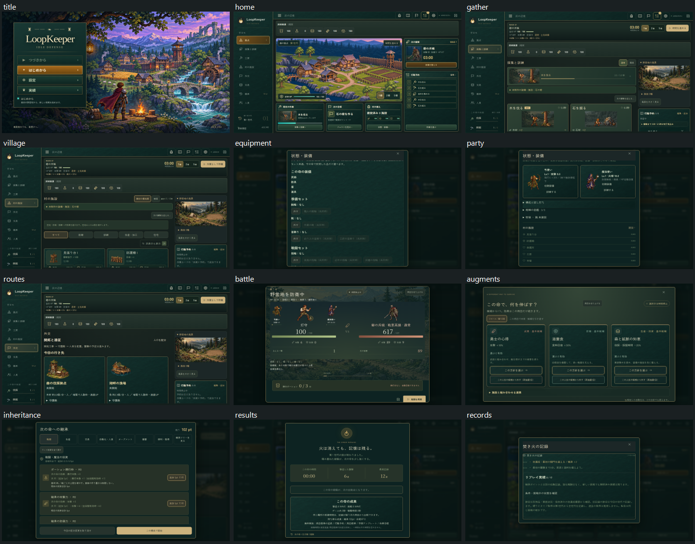

# LoopKeeper 16:9 ビジュアル更新案

実装・現状画像の基準は `62986372cbaba2f9be4babc539881bd6f50bea55`。目標画像は画像生成した抽象テクスチャと装飾CSSを、同一ゲーム画面に重ねて出力しました。日本語、Chromium、検証用セーブです。

[現行要素の一覧](inventory.md) · [画面別の差分](checklist.md) · [描画前後の比較記録](report.json)

12画面すべて採用判断待ちです。

[CIの撮影・比較結果](https://github.com/Min-Konny/loopkeeper/actions/runs/44562878459)。各画面、各解像度で装飾の前後にテキスト、操作属性、画像参照、文書寸法を照合しました。

| 画面 | 1280×720 | 1920×1080 |
| --- | --- | --- |
| #4 タイトル | [現状](current/title-1280x720.png) / [目標](target/title-1280x720.png) | [現状](current/title-1920x1080.png) / [目標](target/title-1920x1080.png) |
| #5 拠点ダッシュボード | [現状](current/home-1280x720.png) / [目標](target/home-1280x720.png) | [現状](current/home-1920x1080.png) / [目標](target/home-1920x1080.png) |
| #6 作業・行動予約 | [現状](current/gather-1280x720.png) / [目標](target/gather-1280x720.png) | [現状](current/gather-1920x1080.png) / [目標](target/gather-1920x1080.png) |
| #7 村・建築 | [現状](current/village-1280x720.png) / [目標](target/village-1280x720.png) | [現状](current/village-1920x1080.png) / [目標](target/village-1920x1080.png) |
| #8 装備・持ち物 | [現状](current/equipment-1280x720.png) / [目標](target/equipment-1280x720.png) | [現状](current/equipment-1920x1080.png) / [目標](target/equipment-1920x1080.png) |
| #9 仲間・育成 | [現状](current/party-1280x720.png) / [目標](target/party-1280x720.png) | [現状](current/party-1920x1080.png) / [目標](target/party-1920x1080.png) |
| #10 探索・ルート | [現状](current/routes-1280x720.png) / [目標](target/routes-1280x720.png) | [現状](current/routes-1920x1080.png) / [目標](target/routes-1920x1080.png) |
| #11 襲撃・戦闘 | [現状](current/battle-1280x720.png) / [目標](target/battle-1280x720.png) | [現状](current/battle-1920x1080.png) / [目標](target/battle-1920x1080.png) |
| #12 オーグメント選択 | [現状](current/augments-1280x720.png) / [目標](target/augments-1280x720.png) | [現状](current/augments-1920x1080.png) / [目標](target/augments-1920x1080.png) |
| #13 継承・転生準備 | [現状](current/inheritance-1280x720.png) / [目標](target/inheritance-1280x720.png) | [現状](current/inheritance-1920x1080.png) / [目標](target/inheritance-1920x1080.png) |
| #14 世代リザルト | [現状](current/results-1280x720.png) / [目標](target/results-1280x720.png) | [現状](current/results-1920x1080.png) / [目標](target/results-1920x1080.png) |
| #15 記録・実績 | [現状](current/records-1280x720.png) / [目標](target/records-1280x720.png) | [現状](current/records-1920x1080.png) / [目標](target/records-1920x1080.png) |

[旧目標画像12枚の履歴](https://github.com/Min-Konny/loopkeeper/tree/codex/ui-reference-library/docs/references/ui/widescreen)
