# 画面別16:9参考画像

元の上下2画面シートから、各画面を独立したワイド画面として再構成しました。単純な縦伸ばし・切り抜きではありません。生成ツールの出力は1672×941（16:9近似、ピクセル丸め）です。文字・数値・機能は参考で、現行仕様を優先してください。

## タイトル

[実装Issue #4](https://github.com/Min-Konny/loopkeeper/issues/4)

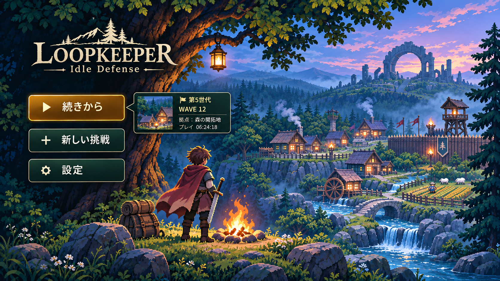

## 拠点ダッシュボード

[実装Issue #5](https://github.com/Min-Konny/loopkeeper/issues/5)

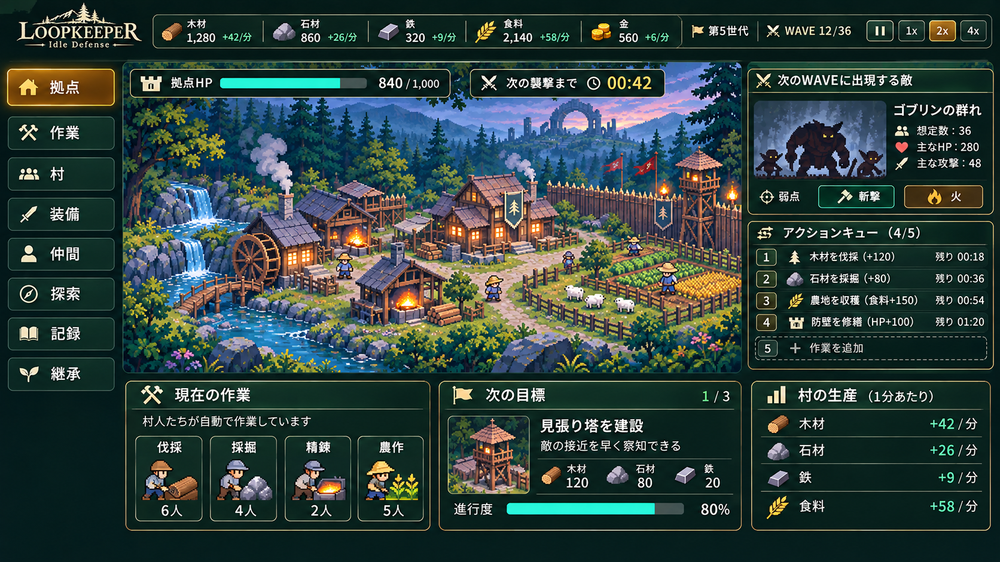

## 作業・行動予約

[実装Issue #6](https://github.com/Min-Konny/loopkeeper/issues/6)

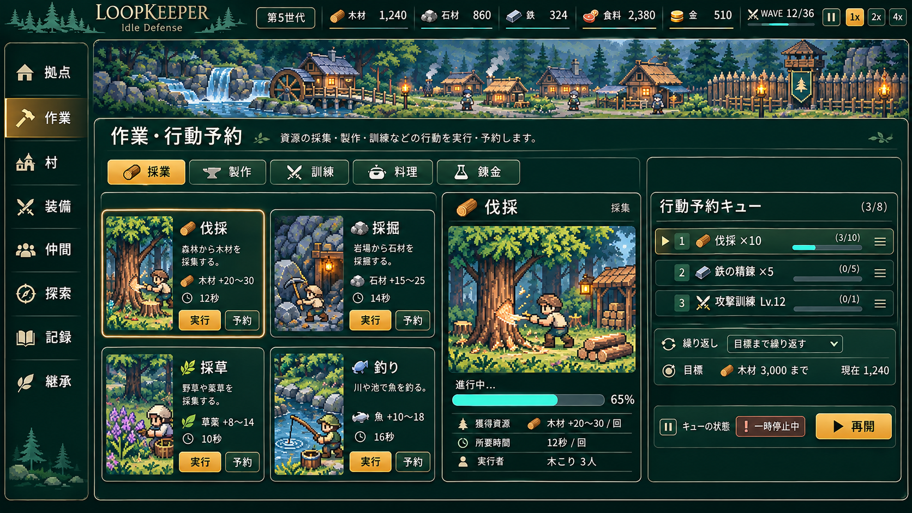

## 村・建築

[実装Issue #7](https://github.com/Min-Konny/loopkeeper/issues/7)

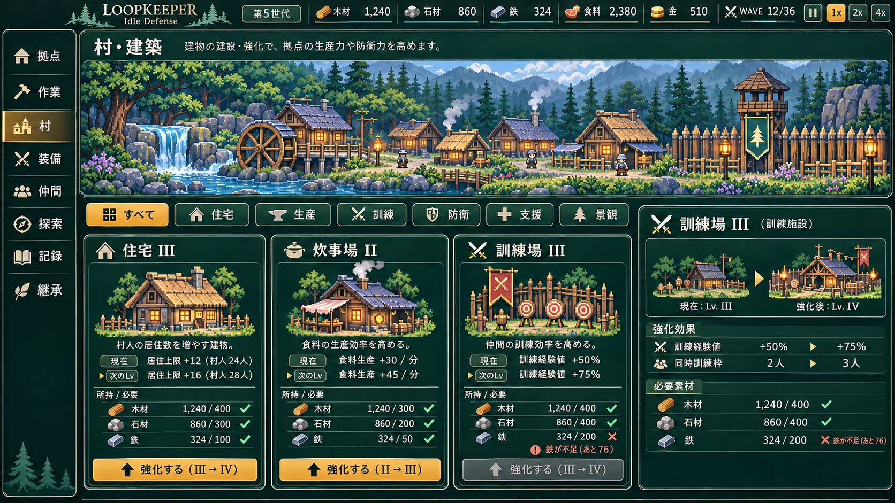

## 装備・持ち物

[実装Issue #8](https://github.com/Min-Konny/loopkeeper/issues/8)

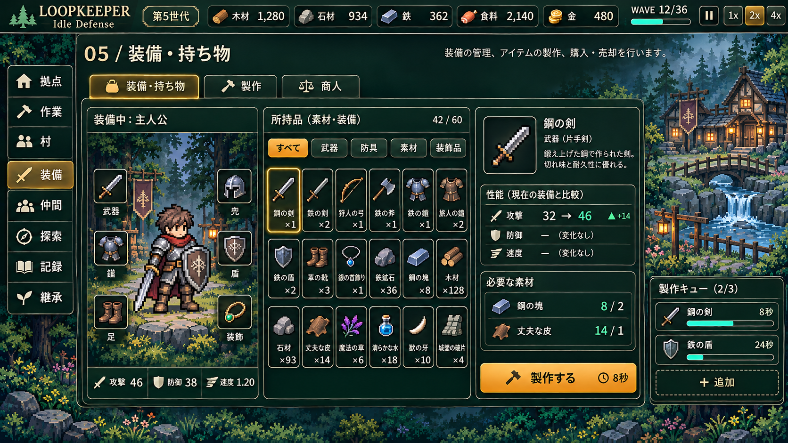

## 仲間・育成

[実装Issue #9](https://github.com/Min-Konny/loopkeeper/issues/9)

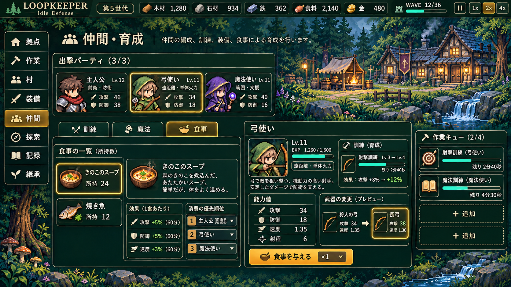

## 探索・ルート選択

[実装Issue #10](https://github.com/Min-Konny/loopkeeper/issues/10)

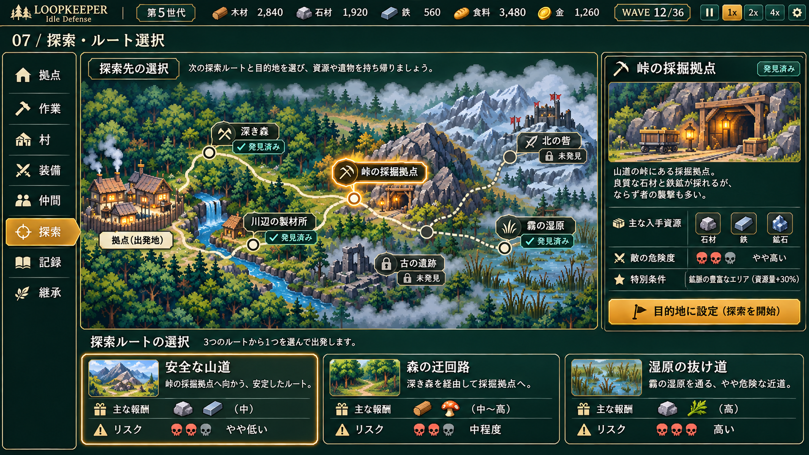

## 襲撃・戦闘

[実装Issue #11](https://github.com/Min-Konny/loopkeeper/issues/11)

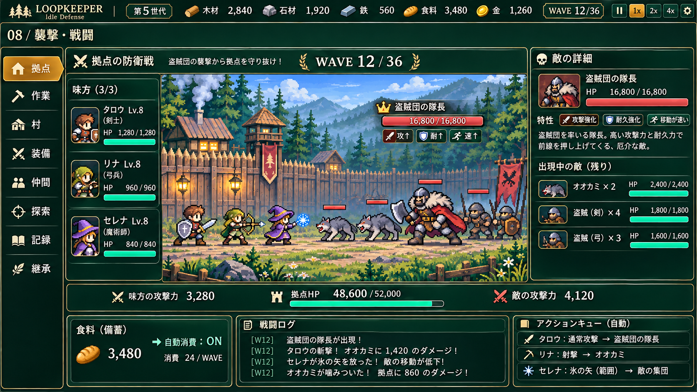

## オーグメント選択

[実装Issue #12](https://github.com/Min-Konny/loopkeeper/issues/12)

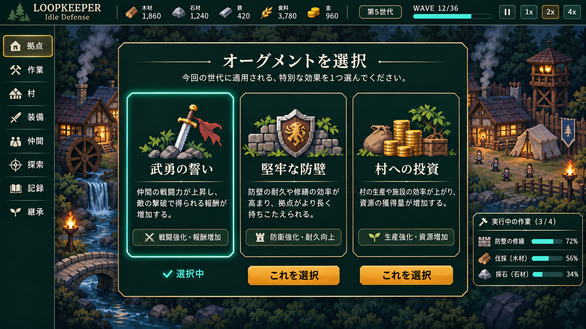

## 継承・転生準備

[実装Issue #13](https://github.com/Min-Konny/loopkeeper/issues/13)

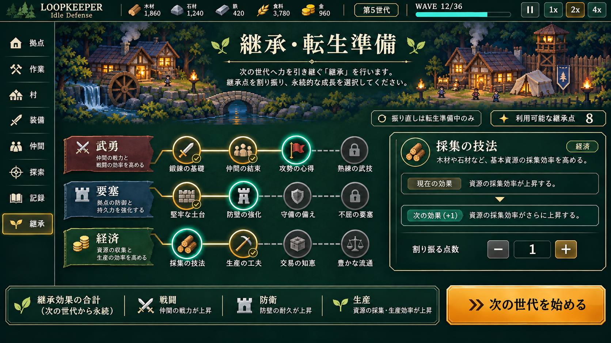

## 世代リザルト

[実装Issue #14](https://github.com/Min-Konny/loopkeeper/issues/14)

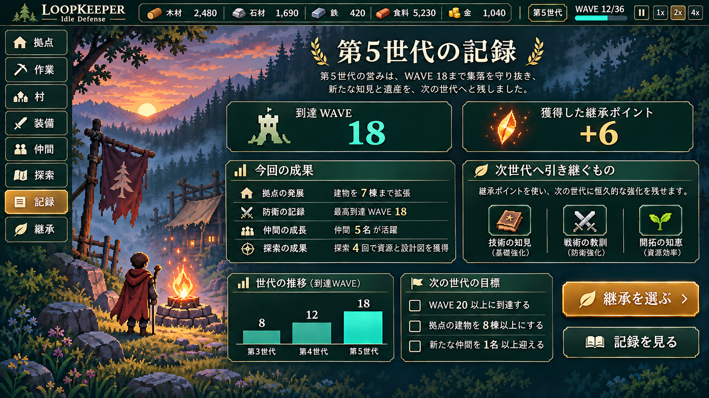

## 記録・実績

[実装Issue #15](https://github.com/Min-Konny/loopkeeper/issues/15)

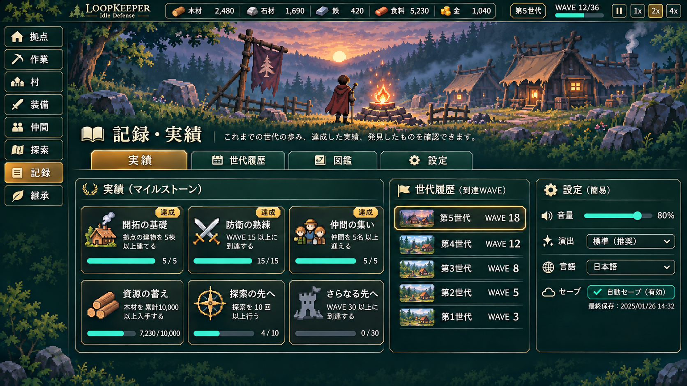

